# Completed comparison figures

These are the original completed comparison values with task-only figure titles.
The proposal branches contain the code and focused tests; this separate branch
holds images for the PR descriptions. The figures are evidence for review, not
a claim that these implementations improve every task or reproduce the papers.

The matrix contains 480 trained models: 16 discrete methods on four tasks and
eight continuous methods on four tasks, each with training seeds 401–405.
Discrete models received 100,000 transitions each; continuous models received
500,000 each. Every original model completed its declared budget. No weak seed
was removed or replaced. All methods and training seeds within a task used the
same qualified host; discrete and continuous task groups used different hosts.

Each measured learning-curve point is the raw return mean of ten evaluation
episodes for one trained model. Thin lines represent the five trained seeds and
heavy lines their mean. Evaluation episodes are nested observations, not extra
independent training seeds. Evaluation uses greedy/deterministic actions. The
rollout-aligned measurement knots are retained; straight connecting segments
do not imply continuously measured performance.

Endpoint panels show all methods on each task, the raw trained-seed points and
descriptive bootstrap intervals from the five trained seeds. These intervals are
not adjusted for multiple comparisons. The task return scales differ and should
not be pooled into a raw cross-task score. Native-method context uses each
method's declared configuration, so it does not isolate an architecture effect.

Controls also have limits. TQC and native SAC differ in temperature objectives
and actor/critic update ordering. PQN made 3,128 optimizer updates per model
versus 24,750 for its replay-based vector DQN control. Equal transition budgets
therefore do not establish equal compute. The TQC setup uses two critics with
hidden layers [256, 256], rather than the larger five-critic paper setup.
The quantile Rainbow variant is distinct from the original categorical agent;
these vector-observation tasks do not reproduce Atari Rainbow.

The original receipts, checkpoints, nested evaluation episodes, precomputed
analysis and all unsuccessful preliminary attempts are preserved separately.
No training, evaluation, statistics or frozen source was rerun to make this
image branch. The separately run post-hoc saved-policy diagnostic is not shown
here and never replaces the primary results. TRPO comparisons are still pending.

The figures were prepared with AI assistance as part of the implementation and
review work. They were plotted from real completed experiment exports.

## Focused comparisons

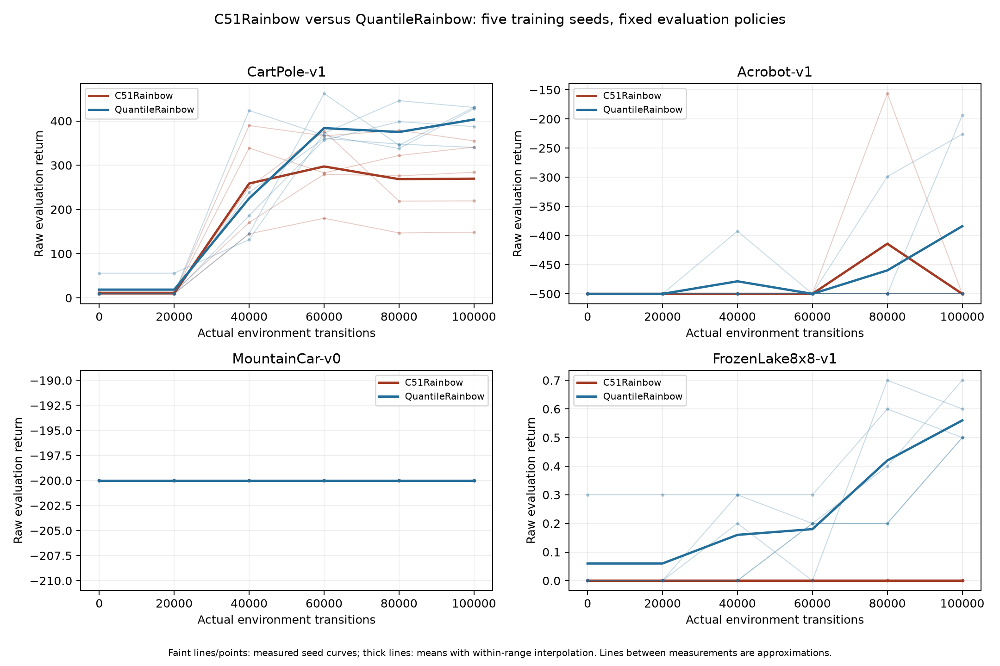

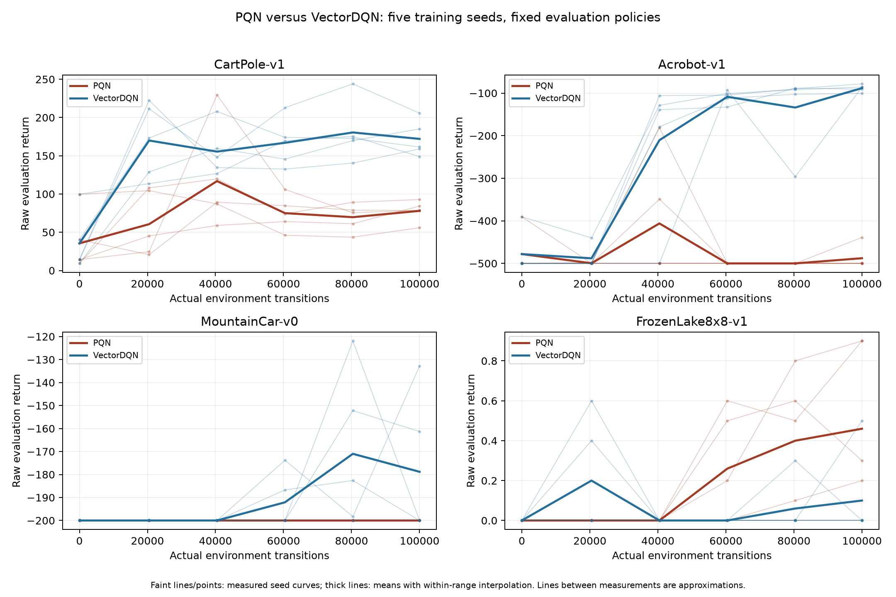

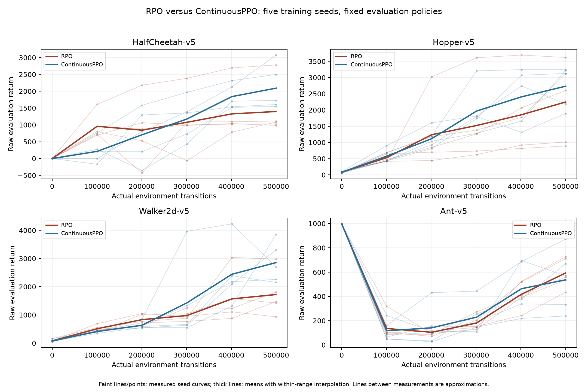

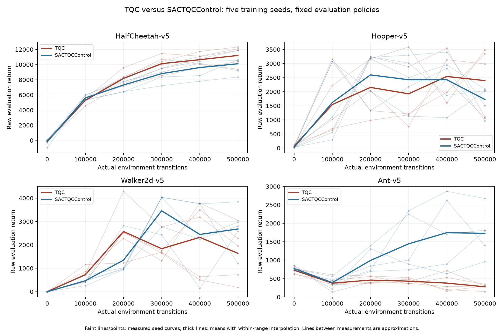

## All-method endpoint context

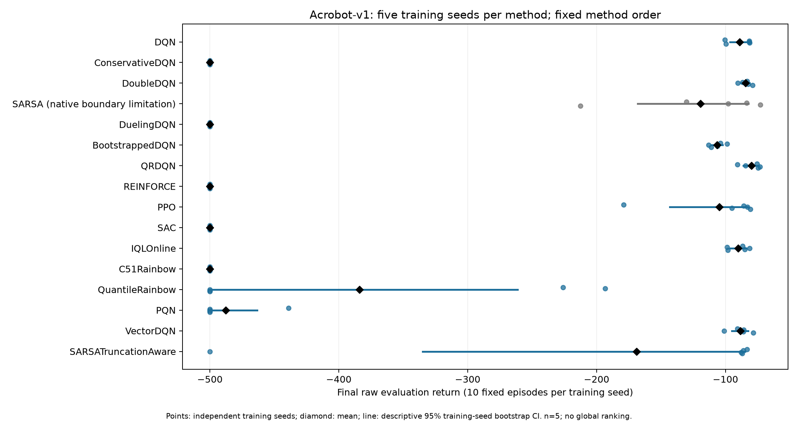

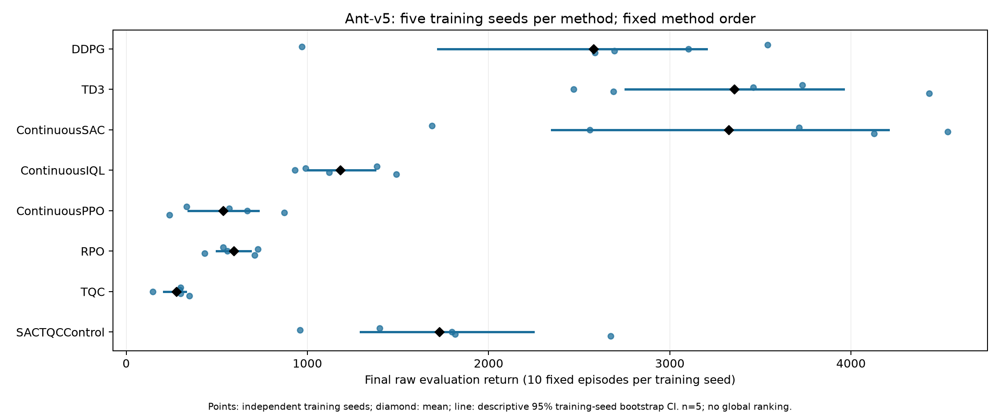

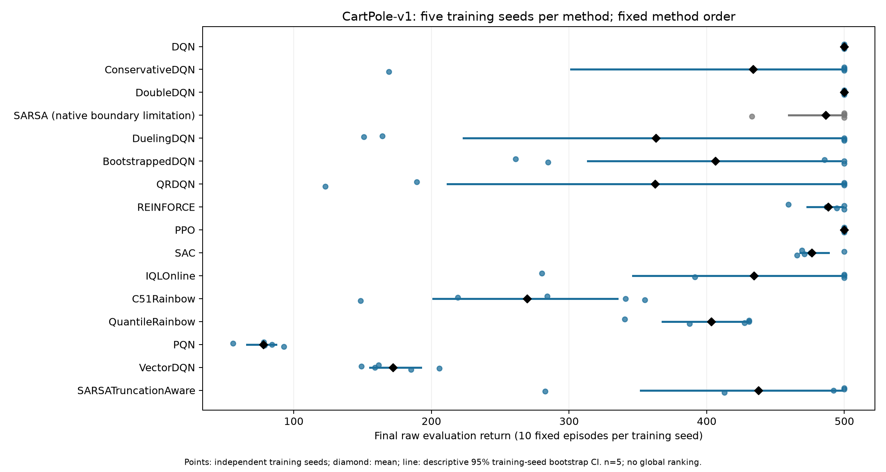

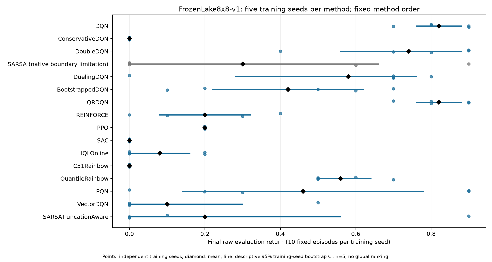

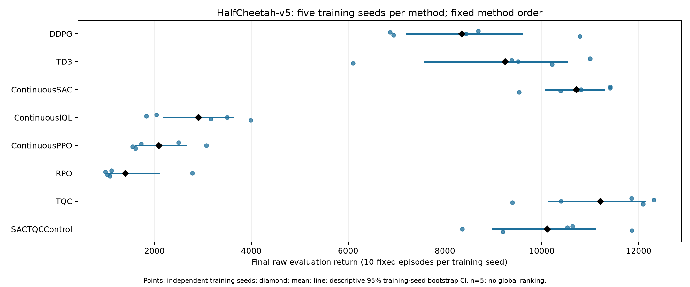

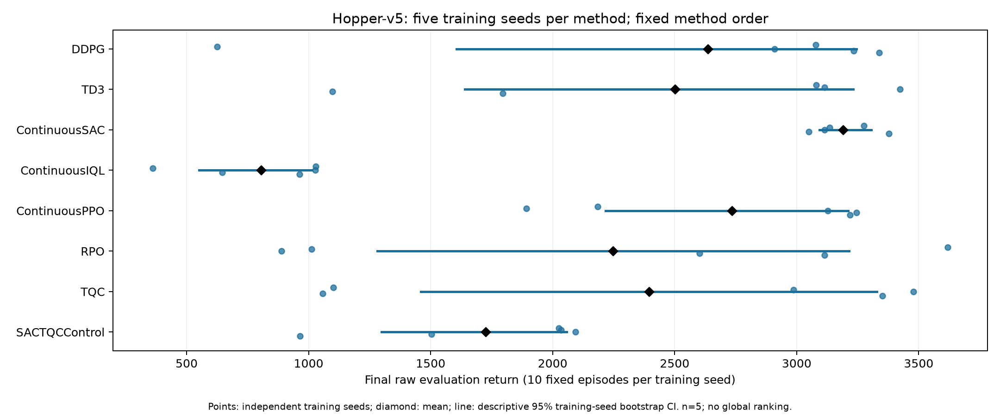

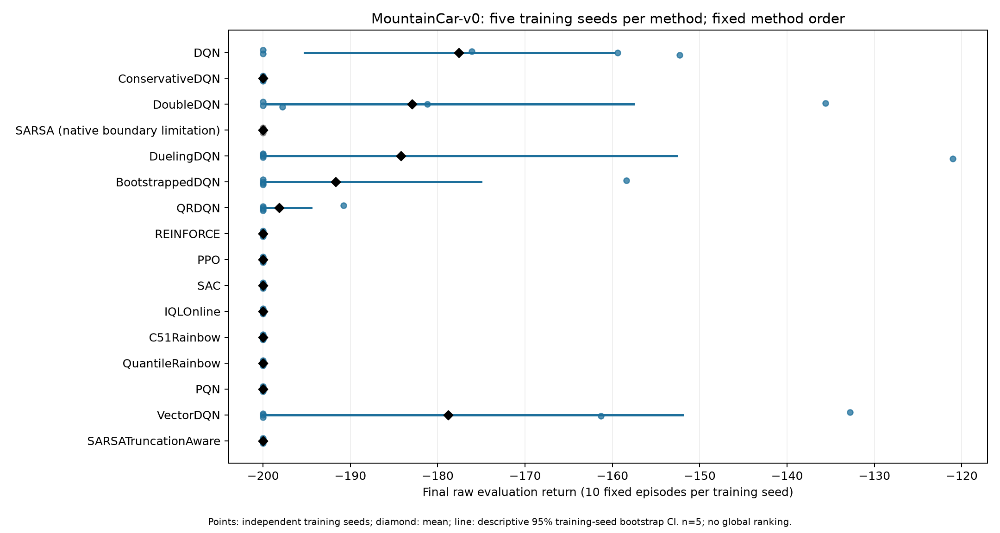

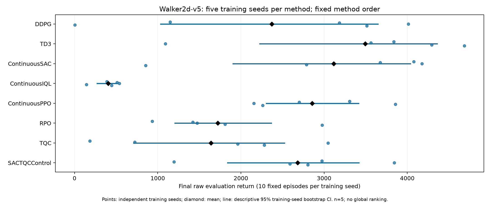
